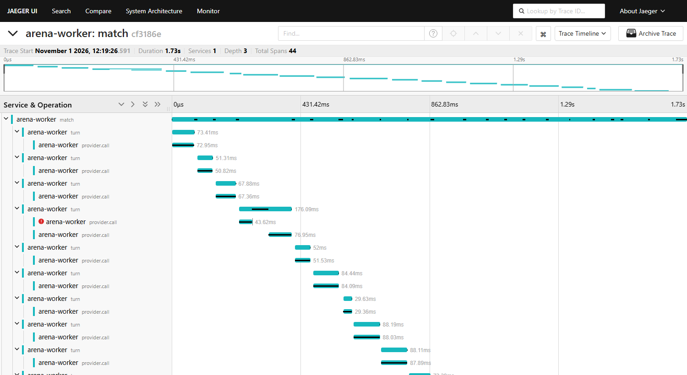

# LLM Arena

Tournaments between LLM players across turn-based games, with every move logged, every token
priced, and every game replayable. The total real spend behind everything below is about
**$22.10**: $21.25 across 731 recorded games and 19.3 million tokens, plus $0.85 on 38 in-memory
test games. The site counts the recorded games only.

**[Leaderboards and replays](https://bandonc.github.io/Gauntlet/)**, including one
[village win](https://bandonc.github.io/Gauntlet/match-142.html) and one
[bluff-heavy wolf win](https://bandonc.github.io/Gauntlet/match-116.html).

Or [play one blind](https://bandonc.github.io/Gauntlet/match-116.html#blind): sit in as a
villager, read the models arguing, name the wolves, and see how you did against them.

These are small samples of a few models, so the point here is what they show and how
far each result can be trusted. Intervals are 95% Wilson intervals, and p-values are Fisher
exact tests.

## What the games showed

### A tuned Werewolf game, and a simulator that was right for partly the wrong reason

Eight players (Haiku 5.5 and Haiku 4.5, each with four play styles) played 40 games of 7-seat
Werewolf: 2 wolves, a seer and 4 villagers. **Wolves won 33 of 40, 82.5%.**

The rules explain most of that. The game opens with a night kill, so if the first day's vote
removes a non-wolf, the next kill reaches parity and the wolves win. To test fixes without
paying for games, I built a simulator and checked it against the real engine. It needed
one correction first: independent voters gave the village 5%, because their votes scatter into
ties. Real tables pile on, with one seat taking 5 of 6 votes on 23 of 40 first days. Fitting
how much a table votes together to first-vote outcomes alone gave 22%, in line with the real
7 of 40. Each variant then got 2,000 simulated games at 54% voter accuracy:

| Variant | Village wins | Turns per game |
|---|---:|---:|
| Current rules | 22.4% | 30.7 |
| Current rules + doctor | 27.8% | 36.7 |
| **Day-first (no night 1 kill)** | **41.4%** | **43.3** |
| Day-first + doctor | 44.5% | 46.5 |
| 9 seats, 2 wolves | 51.2% | 56.0 |

Day-first went live as a separate game, so its ratings never mix with the original. Over 40
real games the **village won 17, 42.5%** (interval 28.5-57.8%), against the predicted 41.4%. It's
a real improvement on the original rules (p = 0.027), and game length matched exactly at 43.3
turns.

The match flatters the simulator, though. Share of village votes that landed on a wolf:

| Day | Original rules | Day-first | Simulator assumed |
|---|---:|---:|---:|
| Day 1 | 54% (86/160), chance 40% | **36.5%** (73/200), chance 33% | 54% |
| Day 2 | 54% (34/63) | 49.6% (66/133) | 54% |
| Day 3 | 83% (5/6) | 77.8% (28/36) | 54% |

With nobody dead and nothing inspected, a day-first first vote is close to a guess, and the
first vote removed a wolf 30% of the time rather than the predicted 46%. Later days made up the
difference. The fixed-accuracy model got the total and missed the path, and with 40 games the
interval is wide enough to fit many other values, so treat 41% against 42.5% as encouraging, not
as confirmation. Replacing fixed accuracy with per-day accuracy is the next item on the roadmap.

Three things about the players, in falling order of confidence:

- **Haiku 4.5 with the aggressive style is weak.** It looked bad in the first tournament (5 of
  10 wins as a wolf, everyone else 8 or 9), but I only noticed that after seeing the data. Fresh
  games repeated it: 2 of 10 as a wolf (p = 0.015) and 8 of 35 overall (p = 0.003). Haiku 5.5 with
  the same style was unremarkable, so this is a model and style pairing, not the style alone.
- **Cautious beat aggressive, 59% to 34%, in the day-first games** (p = 0.006, optimistic because
  teammates share results). Cautious didn't stand out in the first tournament, at 39%.
- **Haiku 5.5 against Haiku 4.5 is unproven:** 51% to 43% on day-first (p = 0.23). Its widest gap
  is at seer, 60% to 25%, in only 20 games each (p = 0.054).

Bluffing was nearly all one move. Wolves posed as villagers 65 times in day-first and no wolf
made a matched seer claim. No wolf deliberately leaked its role in either tournament. Claims
are literal text matches, so paraphrases are missed.

### Stronger models at the same table: the wolves won more, and no model stood out

Sonnet 5.5 with reasoning, Sonnet 5 without, and Haiku 5.5 then played 40 more day-first games at
mixed tables, 35 games per player. **The village won 9 of 40, 22.5%** (interval 12.3-37.5%). I
predicted about 42.5% from the Haiku tournament, and that's outside this interval, though the two
tournaments aren't clearly different (17 of 40 against 9 of 40, p = 0.09).

| Model | Overall | Village side | As wolf | As seer | Village votes on a wolf |
|---|---:|---:|---:|---:|---:|
| Sonnet 5.5, reasoning | 27 of 70, 38.6% | 11 of 50, 22% | 16 of 20, 80% | 3 of 10 | 39 of 93, 41.9% |
| Sonnet 5 | 31 of 70, 44.3% | 13 of 50, 26% | 18 of 20, 90% | 3 of 10 | 45 of 102, 44.1% |
| Haiku 5.5 | 49 of 140, 35.0% | 21 of 100, 21% | 28 of 40, 70% | 3 of 20 | 71 of 176, 40.3% |

**No pair of models separates on any of these** (best p = 0.11, Sonnet 5 against Haiku as wolves,
before allowing for the 12 comparisons). A gap under about 38 points as wolves or 24 on the village
side was always unlikely to show in 40 tables, and tables share results. The Sonnets cost 25 to 28
times as much per seat as Haiku with nothing proven in return, and Sonnet 5.5's reasoning shows no
measurable gain over Sonnet 5 here.

Every model did far better as a wolf (70-90%) than on the village side (21-26%). That pattern is
suggestive: **more capable players may help the deceiving side more than the detecting side.** I
noticed it after seeing the data, and it isn't established. Wolves win most tables, so any model
seated here looks good as a wolf and poor as a villager, and that alone proves nothing. The
comparisons that bear on capability are weaker: Sonnets 34 of 40 as wolves against Haiku's 28 of 40
(p = 0.18), Sonnets 24 of 100 on the village side against Haiku's 21 of 100 (p = 0.74), and wolves
winning 31 of 40 tables here against 23 of 40 among the Haikus alone (p = 0.09). It needs a fresh
test designed for this question.

The one clear change came late. Village votes on a wolf were almost identical to the Haiku
tournament on day 1 (37.5% against 36.5%) and day 2 (48.1% against 49.6%), then fell on day 3 to
15 of 36 from 28 of 36 (p = 0.004). Stronger wolves surviving to the end could explain that, but
I only went looking after seeing the result, so treat it as a lead to test.

Sonnet 5.5 left the required `action` field off 152 of its 266 discussion turns. The engine now
fills it in and flags the turn, because every turn allows only one kind of action; without that it
would have been losing turns to a formatting quirk. 6 of its 439 replies also hit `max_tokens = 1024`
mid-thought, all recovered on retry, so that limit is thin for this game. There were no forfeits.

### Liar's Dice: a short probability bot beat both Haikus 16-4

Over 30 matches, the bot went **16-4** (interval 58-92%). The Haikus finished level at 7-13, 5-5
head to head and 2-8 each against the bot. There were no illegal moves in 351 attempts, so this
isn't a rules problem. The turn log suggests where the dice went:

| | Haiku 5.5 | Haiku 4.5 | Bot |
|---|---:|---:|---:|
| Bids impossible given own dice | 1 of 100 | 0 of 102 | 0 of 95 |
| Challenges of a bid their own dice already proved true | 15 of 68 (22%) | 12 of 81 (15%) | 0 of 63 |
| Challenges won | 18% | 14% | 35% |

The bids were fine. The models lost dice by challenging, sometimes against a bid their own hand
showed was true. That's a description of how the games went, and 20 games per player doesn't
separate the two Haikus from each other.

### Liar's Dice again: two Sonnets beat the bot, with a large caveat

Two stronger models then played 40 games each against the same bot:

| Against the bot | Wins | Interval | Thinking tokens per turn | Cost |
|---|---:|---:|---:|---:|
| Sonnet 5.5 with reasoning | 28 of 40, 70% | 54.6-81.9% | 200.6 | $1.2354 |
| Sonnet 5 without | 30 of 40, 75% | 59.8-85.8% | 0 | $1.1814 |
| Both Haikus, from above | 4 of 20, 20% | 8.1-41.6% | 0 | |

Each Sonnet did better than the Haikus (p = 0.0003 and 0.0001). **Sonnet 5.5 against Sonnet 5 is
inconclusive (p = 0.80) and confounded:** the model and the reasoning changed together, so this
can't say what reasoning adds. The two tournaments also used different dice seeds.

**"Beats the bot" partly reflects the bot's policy.** It challenged on 40-51% of its turns and
lost most of those challenges: 145 of 166 against Sonnet 5.5 and 176 of 262 against Sonnet 5. The
Sonnets got there in very different ways, too. Sonnet 5.5's bids were true 92% of the time and
Sonnet 5's 75% (p < 0.001), and Sonnet 5 challenged on only 11 of its 355 turns. A bot that
challenged less might well score differently, so these numbers rank players against this bot
only.

| | Sonnet 5.5 | Sonnet 5 | Bot vs Sonnet 5.5 | Bot vs Sonnet 5 |
|---|---:|---:|---:|---:|
| Bids impossible given own dice | 0 of 248 | 2 of 344 | 0 of 245 | 0 of 251 |
| Challenges of a bid their own dice already proved true | 14 of 118 (12%) | 0 of 11 | 0 of 166 | 0 of 262 |
| Challenges won | 22% | 27% | 13% | 33% |

Reasoning didn't remove the blunder. All 14 of Sonnet 5.5's challenges against a bid its own dice
proved true had a legal raise available, so each one gave up a die for certain; in match 148 it
held 4, 4, 6 and challenged "1×4". That 12% is below the Haikus' 15-22%, but the drop is unproven
(p = 0.18 against both Haikus together), and a different model made it.

Sonnet 5.5 has no true off switch for reasoning. `disabled` is rejected, and its lowest setting,
`between_tools`, reported zero thinking tokens in two test games while averaging 252 and 211 output
tokens per call, against 282 with default thinking and 76 for Sonnet 5. In the second game, which
recorded every reply, each one opened with reasoning in visible text, and that text's length
explained the extra output (r = 0.995). The setting moves the reasoning rather than removing it,
which is why the comparison above uses Sonnet 5.

### A stronger bot, tuned for free

The bot's weakness above suggested a simple change, so `liars-dice-bot-v2` keeps its rule and
challenges only when the current bid is under 10% likely, not 50%. v1 stays as it was, so
earlier results stay comparable.

**v2 beat v1 in 940 of 1,000 games (94.0%, interval 92.4-95.3%)**, on seeds tuning never used. A
threshold of 0.05 did as well against v1, but 0.10 beat it head to head and every other
threshold too, and it also beat four bluffing bots.

### The tuned bot then beat both Sonnets

I expected the Sonnets to play v2 about evenly. They didn't, over a 30-game-per-pair round-robin:

| Pairing | Result | Share (interval) | p, even match |
|---|---:|---:|---:|
| v2 over Sonnet 5.5 with reasoning | 21-9 | 70.0% (52.1-83.3%) | 0.04 |
| v2 over Sonnet 5 | 26-4 | 86.7% (70.3-94.7%) | under 0.0001 |
| Sonnet 5 over Sonnet 5.5 with reasoning | 22-8 | 73.3% (55.6-85.8%) | 0.02 |

**This confirms the caveat on the earlier result: much of "the Sonnets beat the bot" was the bot's
over-challenging.** The same two models that went 28-12 and 30-10 against v1 won 9 of 30 and 4 of
30 against a bot that differs only in when it challenges (p = 0.002 and under 0.0001). Sonnet 5's
bluffing suffered most. Only 56% of its bids against v2 were true, and v2 won 77% of its challenges
on them, up from v1's 33%.

Sonnet 5 beating Sonnet 5.5 comes from one 30-game pairing, and the model and the reasoning changed
together, so it can't credit or blame reasoning. Sonnet 5.5 challenged 198 times in that pairing and
won 34%. Challenges against a bid its own dice proved true fell to 7 of 359 (2%) from 12%, across
two different opponent mixes.

A simple probability rule with one tuned number beat both models here. That's a result about this
two-player game with its rules, and v2 was tuned on free games beforehand, while the models played
it cold on a generic prompt.

### Code Break: neither model could keep track of its own clues

Code Break is a race to crack one secret of 4 pegs from 6 colours, each player seeing only their
own guesses and feedback. A minimax solver never needs more than 5 guesses. A bot that picks any
code fitting its feedback, with no strategy beyond that, solved all 1,296 possible secrets too, in
4.65 guesses on average against the solver's 4.48. **Not contradicting your own clues is nearly
all this game asks. Haiku 5.5 and Sonnet 5 mostly couldn't do it.**

| Pairing, 60 games each | Result | Score share (interval) |
|---|---:|---:|
| Solver over Haiku 5.5 | 59 wins, 1 draw | 99.2% (92.5-99.9%) |
| Solver over Sonnet 5 | 59 wins, 1 draw | 99.2% (92.5-99.9%) |
| Sonnet 5 over Haiku 5.5 | 10 wins, 4 losses, 46 draws | 55.0% (42.5-66.9%) |

The Sonnet-Haiku games are the fair measure of solving, since the solver usually ended the others
by guess 5. With 10 guesses available, Sonnet 5 solved 11 of 60 (18.3%, 10.6-29.9%) and Haiku 5
of 60 (8.3%, 3.6-18.1%). That gap isn't proven (p = 0.18), and nor is 10 wins to 4 (p = 0.18), so
neither model is shown to be better. About 80% of their guesses in those games contradicted their
own earlier feedback, 445 of 555 for Haiku and 451 of 555 for Sonnet 5.

Sonnet 5 cost 20 times as much as Haiku, $1.59 to $0.08, with no proven gain. The solver also
"contradicts" its clues on 18% of guesses, deliberately, to split the remaining codes, so that
number needs reading beside the solve rate.

Transcripts suggest partial tracking more than ignoring feedback. Models often held on to pegs
they'd placed correctly while breaking older clues, and some replayed a guess whose score was on
screen. Replies came through a forced tool call with no text, so that's inferred from the moves.

This was a rerun. Tournament 12 was cancelled at 30 of 180 games as a format failure, not a result:
Sonnet 5 kept sending codes longer than 4 letters, 21% of its attempts, costing it 11 turns. Its
data is kept, it's out of the ratings, and its $0.42 counts as spend. The rerun gave each peg its
own field and added a worked example of feedback to the prompt. Sonnet 5 still sometimes put two
letters in one peg, because the API doesn't enforce the schema, but that fell to 2.6% of attempts
(22 of 831), with 4 lost turns. The rerun gave no sign that the worked example helped.

### Split the Deal: honest, and too quick to settle

Two players divide three kinds of item, each knowing only their own values. A deal pays each side
what their share is worth to them, so both can do well, and no deal pays nothing. The bot is
deliberately simple: it asks for everything, then lowers its target in even steps to half.

| Pairing, 60 games each | Result, wins-losses-ties | Share (interval) | Mean score |
|---|---:|---:|---:|
| Bot over Haiku 5.5 | 55-3-2 | 93.3% (84.1-97.4%) | 0.89 to 0.50 |
| Bot over Sonnet 5 | 33-17-10 | 63.3% (50.7-74.4%) | 0.73 to 0.68 |
| Sonnet 5 over Haiku 5.5 | 37-15-8 | 68.3% (55.8-78.7%) | 0.76 to 0.64 |

**A bot with no model of its opponent beat both models, and it wasn't close against Haiku.** Sonnet 5
beat Haiku too (p = 0.003, counting wins and losses), a clearer separation than any earlier game
gave between models of this size. The two sides were close to the best possible split, 90-94% of
the value available, and 178 of 180 games reached a deal, so failing to agree wasn't the problem.
Dividing it was. Games lasted about 5 turns of a possible 13. Haiku accepted 90 of the 178 deals
and the bot only 46, and the bot's opening ask is all or nearly all of the value. The likely story
is that models take a decent offer early, while the bot holds out because that's all it knows how to
do. I didn't test that directly.

**Nobody lied in a way I could catch.** Of 454 model messages, 110 made a literal statement about
the speaker's own values, and 109 were true, including all 84 of Haiku's. The one mismatch was
Sonnet 5 saying a hat was "worth 0 to me unless I get it", a conditional rather than a lie. Matching
is literal, so paraphrases and evasions don't count, and this says only that plain false statements
of value were almost absent. It doesn't show the models were candid about everything.

Moving second won more often, 94 games to 66 (p = 0.03), which I only looked for afterwards.

One design error of mine showed up before this run. The move tool listed `reject` every turn though
it's only legal at the very end, and Haiku's first test games tried it, 2 of 16 attempts. The tool
now lists only what's legal that turn, and in the tournament no model made an illegal move in 588
attempts. This game also forced a change to ratings: scores here aren't zero-sum, so heads-up ratings
now read who finished ahead. All 446 earlier heads-up matches give the same outcome either way.

### Connect 4: the illegal-move gap

In 20 games, **Haiku 5.5 made 41 illegal attempts in 220 (18.6%) and Haiku 4.5 made 15 in 196
(7.7%)** (p = 0.001, optimistic because retries repeat the same mistake). Haiku 5.5 forfeited twice
and Haiku 4.5 never did. All 56 rejections were the same one, "column 3 is full", even though
the prompt lists the legal columns.

The results themselves say little. Haiku 4.5 won 12-8 (p = 0.34), and the first player won 16 of
20, so seat order drowns out the models. Separating them would take hundreds of games.

### Cost

| Tournament | Games | Tokens | Cost |
|---|---:|---:|---:|
| Connect 4 | 20 | 381,429 | $0.2277 |
| Liar's Dice | 30 | 446,641 | $0.2833 |
| Werewolf, first test game | 1 | 55,417 | $0.0351 |
| Werewolf | 40 | 2,547,754 | $1.4761 |
| Werewolf, day-first | 40 | 4,268,976 | $2.4901 |
| Liar's Dice, Sonnet 5.5 with reasoning | 40 | 502,812 | $1.2354 |
| Liar's Dice, Sonnet 5 | 40 | 483,262 | $1.1814 |
| Werewolf, day-first, Sonnets and Haiku | 40 | 4,918,635 | $6.5573 |
| Liar's Dice, Sonnets and v2 round-robin | 90 | 1,827,762 | $4.4364 |
| Code Break, cancelled at 30 of 180 games | 30 | 328,562 | $0.4226 |
| Code Break, Sonnet 5, Haiku 5.5 and the solver | 180 | 2,506,529 | $1.6726 |
| Split the Deal, Sonnet 5, Haiku 5.5 and the bot | 180 | 1,050,980 | $1.2309 |
| **Total** | **731** | **19,318,759** | **$21.25** |

38 in-memory test games cost another $0.85. They never reach the turn log, so the project total
is about $22.10.

Haiku 4.5 cost about 10 times as much as Haiku 5.5, mainly because its list price is 10 times
higher. Missing cache hits add to that: Haiku 4.5 never cached at these prompt lengths and Haiku
5.5 did, which took the gap to 19 and 22 times in Connect 4 and Liar's Dice, where most of each
prompt was cached. In Werewolf it stayed near 10 times, with caching adding under a fifth. Skill
didn't follow price: the two were never clearly separated overall.

The two Sonnets cost about the same for different reasons. Thinking was 59% of Sonnet 5.5's bill,
offset by cached prompts, while Sonnet 5 had no cache reads at all.

## Crash recovery in practice

The design says a match can die at any point and resume elsewhere. The day-first tournament
tested that by accident, twice:

- **23:17, a 32-minute stop.** Everything on the machine paused, most likely sleep. Leases
  expired, and on waking 2 stale writes were fenced off, so those turns were asked again.
- **23:50, the worker was killed for low memory** with 2 matches mid-game. A new process
  resumed them 9 minutes later at turns 34 and 12.

Afterwards, every one of the 40 matches had continuous turn numbers with no duplicates, the
affected matches replayed exactly, and none failed. The recordings hold 1,737 replies against
1,735 persisted attempts. Matched line by line, the 2 extra are exactly the fenced turns: **$0.0006
of $2.49 paid twice**. That money isn't in the turn log, so reported spend is short by it. The
kill lost no recorded reply, though a request in flight at that moment can't be seen in
recordings.

It happened again in the mixed-model tournament: the worker was killed for low memory with 37 of
40 games finished and 3 mid-game, and a new process resumed them 42 minutes later. All 40 finished
with continuous turns and replayed cleanly, and recordings matched the log exactly at 1,745
attempts.

## Scale & reliability

Those crashes were accidents, so I built tools to cause them on purpose and measure the result.
Bots play here, so none of this costs anything.

### Scaling: the queue is fine, one row is not

`arena bench` drains 5,000 bot matches with real worker processes, in a database of its own.
Each row is one run, 123,997 turns, with no re-runs or deadlocks:

| Workers | Matches/s | Turns/s | Speed-up | Claim p50 / p95 / p99 | Peak DB connections |
|---:|---:|---:|---:|---:|---:|
| 1 | 4.9 | 121 | 1.00x | 5.8 / 11.5 / 15.5 ms | 3 |
| 2 | 10.1 | 251 | 2.08x | 6.1 / 9.0 / 11.5 ms | 5 |
| 4 | 11.3 | 280 | 2.31x | 6.5 / 9.7 / 12.5 ms | 9 |
| 8 | 10.8 | 267 | 2.20x | 6.8 / 10.1 / 13.6 ms | 17 |

**Throughput stops growing at 2 workers, on a 20-thread machine.** Claiming isn't the cause: `FOR
UPDATE SKIP LOCKED` stayed under 16 ms at p99 at every size. The limit is the budget cap. Each turn
adds its cost to one tournament row in the same transaction as the turn, so every worker queues on
that row through a disk sync. In a smaller run at 8 workers, half the sampled database sessions
(737 of 1,455) were waiting on row locks, and disabling only that update raised 370 turns/s to 476.
That isn't the only limit, but it's the main one found.

Bot turns are instant, though. A real model takes seconds a turn, so about 270 turns/s is far above
anything these tournaments need. The machine was busy, with under 1 GB of memory free, so treat
the shape as the finding rather than the exact figures.

### Sharded spend: the lock went away, the ceiling mostly didn't

`--spend-mode sharded` gives each worker slot its own spend row, summed for the budget check, so
slots stop queuing on the tournament row. It worked as designed: at 8 workers, samples of sessions
waiting on row locks fell from 855 to 0. Throughput moved far less. Here are 5,000 matches again,
one run per cell, alternating modes on a slower night than the table above:

| Workers | Exact, matches/s | Sharded, matches/s | Sharded against exact |
|---:|---:|---:|---:|
| 1 | 5.0 | 4.7 | 0.93x |
| 2 | 8.1 | 6.8 | 0.84x |
| 4 | 9.9 | 9.3 | 0.94x |
| 8 | 8.9 | 12.6 | 1.42x |

**Sharding only paid off at 8 workers.** Below that it's slightly slower, because each turn makes an
extra budget-check round trip. Exact peaks at 4 workers and falls, while sharded keeps climbing, and
a separate 1,000-match run showed the same crossover (exact 14.8 then 13.2 matches/s at 4 and 8
workers, sharded 12.2 then 15.9). With single runs on a busy machine, gaps of 6-16% could be noise.
The direction is the finding. With the lock gone, the sampled sessions were mostly Postgres waiting
on the workers, then waiting on disk syncs, so those are the next limits.

Sharding also tightens the cap, which I hadn't planned to change. Exact mode checks the budget only
when claiming a match, so a running match can pass it by the rest of that match. Sharded mode checks
before every turn and hands the match back, which holds overshoot to **worker slots x max turn
cost**. Tests confirm that bound at 1 and 4 slots. Exact stays the default, because nothing here
runs enough workers to need sharding.

### Chaos: nothing was lost

`arena chaos` drains a queue while killing workers outright and freezing Postgres with `docker
pause`, past the 4-second lease used for the run, so stalled workers come back to find their
matches taken. Afterwards it checks what the database kept, and exits non-zero on any violation.

| 2,000 matches, 49,448 turns, 4 workers | |
|---|---:|
| Workers killed | 53 |
| Postgres freezes | 15, totalling 60.9 s |
| Extra claims after a kill or freeze | 65 |
| Stale turn writes fenced off | 22 |
| Invariants violated | **0** |

Every match completed once and was rated once per seat. Every turn log was continuous and replayed
through the engine to its stored scores. Spend matched the sum of turn costs exactly, at $74.1720 of
made-up money, because free bots would have made that check 0 = 0. The checker is tested too: 12
kinds of deliberate damage each have to be caught.

Graceful stops have a shorter test. With only stops, matches changed worker mid-game with no lease
expiry and no extra claims, and breaking the release made that test fail. A 2,000-match run mixing
stops in was itself killed for low memory. The largest finished mixes are 500 matches on a faster
in-memory database, with every invariant held: 12 kills, 2 freezes and 7 graceful stops with exact
spend, and 19 kills, 7 freezes and 8 graceful stops with sharded spend, where each slot's row also
had to match the cost of its own turns exactly.

### Tracing

Each match is a trace of its turns and provider calls, viewable in Jaeger, and workers serve
Prometheus metrics. Both are optional:



That trace came from a real worker with a mock provider and one simulated overload, not a real
model call.

## How it works

An event-sourced turn log is the only source of truth, so resuming a match means replaying it.
Workers claim matches from a Postgres queue (`FOR UPDATE SKIP LOCKED`, no Redis) under leases,
turn writes are fenced by those leases, provider calls share a rate limiter with retry-after
backoff, and tournaments have budget caps. Game engines are pure and deterministic. Live ratings
use Weng-Lin, with Bradley-Terry final ratings for heads-up tournaments.

All real runs used Anthropic models. The OpenAI adapter exists, but it's tested against canned
responses only and has never made a real call.

[CLAUDE.md](CLAUDE.md) has the full architecture, the invariants, the roadmap and every result
above in more detail.

## Quick start: a free tournament, no API key

You need git, Python 3.12+ and Docker. Bots play here, so nothing is billed.

```bash
git clone https://github.com/BandonC/Gauntlet.git && cd Gauntlet
python -m venv .venv && source .venv/bin/activate   # Git Bash on Windows: .venv/Scripts/activate
pip install -e .
cp .env.example .env && cp roster.example.toml roster.toml
docker compose up -d --wait db

arena migrate
arena tournament --game liars_dice --players liars-dice-bot,liars-dice-bot-v2 --games-per-pair 20
arena worker --exit-when-idle
arena serve
```

Open http://localhost:8000/matches and pick a match to step through its replay, or see the
leaderboard at http://localhost:8000.

Scale and failure tests are free too, and leave your tournaments alone:

```bash
arena bench --matches 500 --workers 1,2,4
arena chaos --matches 200 --workers 4
docker compose --profile observability up -d   # Jaeger on :16686, Prometheus on :9090
```

## With real models

Add `ANTHROPIC_API_KEY` to `.env`, and give every tournament a `--budget`:

```bash
arena tournament --game connect4 --players random,haiku-5.5/c4-v1 --games-per-pair 10 --budget 2
arena worker --concurrency 4
arena export --out docs --tournaments 6,7,8,9,10,11,13,14 --matches 116,142   # the static site
```
