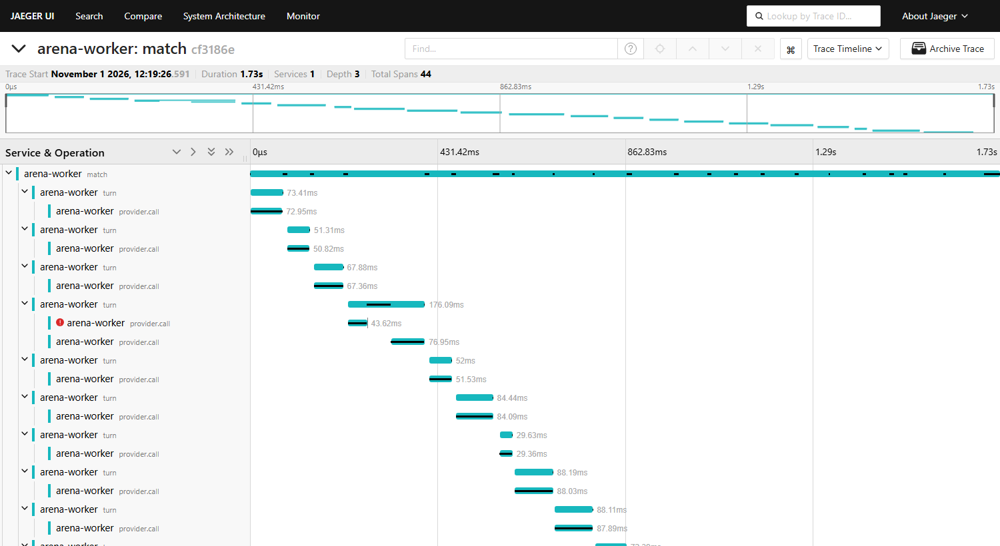

# Scale & reliability

The [crashes in the findings](findings.md#crash-recovery-in-practice) were accidents, so I built tools to cause them on purpose and measure the result.
Bots play here, so none of this costs anything.

## Scaling: the queue is fine, one row is not

`arena bench` drains 5,000 bot matches with real worker processes, in a database of its own.
Each row is one run, 123,997 turns, with no re-runs or deadlocks:

| Workers | Matches/s | Turns/s | Speed-up | Claim p50 / p95 / p99 | Peak DB connections |
|---:|---:|---:|---:|---:|---:|
| 1 | 4.9 | 121 | 1.00x | 5.8 / 11.5 / 15.5 ms | 3 |
| 2 | 10.1 | 251 | 2.08x | 6.1 / 9.0 / 11.5 ms | 5 |
| 4 | 11.3 | 280 | 2.31x | 6.5 / 9.7 / 12.5 ms | 9 |
| 8 | 10.8 | 267 | 2.20x | 6.8 / 10.1 / 13.6 ms | 17 |

**Throughput stops growing at 2 workers, on a 20-thread machine.** Claiming isn't the cause: `FOR
UPDATE SKIP LOCKED` stayed under 16 ms at p99 at every size. The limit is the budget cap. Each turn
adds its cost to one tournament row in the same transaction as the turn, so every worker queues on
that row through a disk sync. In a smaller run at 8 workers, half the sampled database sessions
(737 of 1,455) were waiting on row locks, and disabling only that update raised 370 turns/s to 476.
That isn't the only limit, but it's the main one found.

Bot turns are instant, though. A real model takes seconds a turn, so about 270 turns/s is far above
anything these tournaments need. The machine was busy, with under 1 GB of memory free, so treat
the shape as the finding rather than the exact figures.

## Sharded spend: the lock went away, the ceiling mostly didn't

`--spend-mode sharded` gives each worker slot its own spend row, summed for the budget check, so
slots stop queuing on the tournament row. It worked as designed: at 8 workers, samples of sessions
waiting on row locks fell from 855 to 0. Throughput moved far less. Here are 5,000 matches again,
one run per cell, alternating modes on a slower night than the table above:

| Workers | Exact, matches/s | Sharded, matches/s | Sharded against exact |
|---:|---:|---:|---:|
| 1 | 5.0 | 4.7 | 0.93x |
| 2 | 8.1 | 6.8 | 0.84x |
| 4 | 9.9 | 9.3 | 0.94x |
| 8 | 8.9 | 12.6 | 1.42x |

**Sharding only paid off at 8 workers.** Below that it's slightly slower, because each turn makes an
extra budget-check round trip. Exact peaks at 4 workers and falls, while sharded keeps climbing, and
a separate 1,000-match run showed the same crossover (exact 14.8 then 13.2 matches/s at 4 and 8
workers, sharded 12.2 then 15.9). With single runs on a busy machine, gaps of 6-16% could be noise.
The direction is the finding. With the lock gone, the sampled sessions were mostly Postgres waiting
on the workers, then waiting on disk syncs, so those are the next limits.

Sharding also tightens the cap, which I hadn't planned to change. Exact mode checks the budget only
when claiming a match, so a running match can pass it by the rest of that match. Sharded mode checks
before every turn and hands the match back, which holds overshoot to **worker slots x max turn
cost**. Tests confirm that bound at 1 and 4 slots. Exact stays the default, because nothing here
runs enough workers to need sharding.

## Chaos: nothing was lost

`arena chaos` drains a queue while killing workers outright and freezing Postgres with `docker
pause`, past the 4-second lease used for the run, so stalled workers come back to find their
matches taken. Afterwards it checks what the database kept, and exits non-zero on any violation.

| 2,000 matches, 49,448 turns, 4 workers | |
|---|---:|
| Workers killed | 53 |
| Postgres freezes | 15, totalling 60.9 s |
| Extra claims after a kill or freeze | 65 |
| Stale turn writes fenced off | 22 |
| Invariants violated | **0** |

Every match completed once and was rated once per seat. Every turn log was continuous and replayed
through the engine to its stored scores. Spend matched the sum of turn costs exactly, at $74.1720 of
made-up money, because free bots would have made that check 0 = 0. The checker is tested too: 12
kinds of deliberate damage each have to be caught.

Graceful stops have a shorter test. With only stops, matches changed worker mid-game with no lease
expiry and no extra claims, and breaking the release made that test fail. A 2,000-match run mixing
stops in was itself killed for low memory. The largest finished mixes are 500 matches on a faster
in-memory database, with every invariant held: 12 kills, 2 freezes and 7 graceful stops with exact
spend, and 19 kills, 7 freezes and 8 graceful stops with sharded spend, where each slot's row also
had to match the cost of its own turns exactly.

## Tracing

Each match is a trace of its turns and provider calls, viewable in Jaeger, and workers serve
Prometheus metrics. Both are optional:

That trace came from a real worker with a mock provider and one simulated overload, not a real
model call.
